<div align="center">

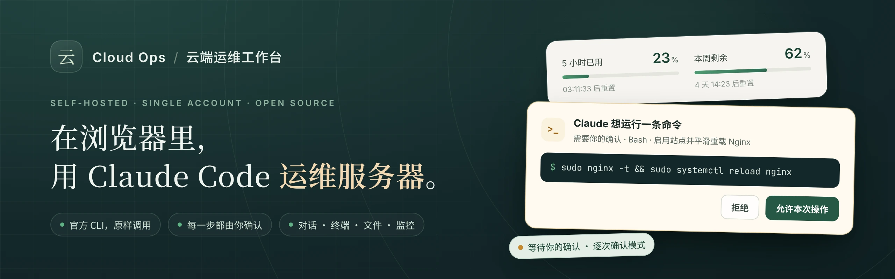

<h1>浮生氪劳德工作台</h1>

<p><b>在浏览器里，用 Claude Code 运维你的云服务器。</b></p>

<p>对话 · 审批 · 终端 · 文件 · 运行监控，一个页面全部搞定。<br>插件 · 创意工坊 · 11 款皮肤，随你打造。<br>自托管 · 单账号 · 每一步都由你确认。</p>

<p>
<a href="https://github.com/qiuxinyuan321/cloud-ops-workbench/actions/workflows/ci.yml"></a>


<a href="LICENSE"></a>
</p>

<p>
<a href="#快速开始"><b>快速开始</b></a> ·
<a href="docs/ARCHITECTURE.md"><b>工作原理</b></a> ·
<a href="docs/DEPLOYMENT.md"><b>部署指南</b></a> ·
<a href="docs/PLUGINS.md"><b>插件开发</b></a> ·
<a href="SECURITY.md"><b>安全模型</b></a> ·
<a href="DISCLAIMER.md"><b>免责声明</b></a>
</p>

</div>

> [!CAUTION]
> **使用前请先阅读 [免责声明](DISCLAIMER.md)。**
>
> - 这是一个**非官方**的爱好者自用项目，与 Anthropic 没有任何隶属或合作关系。
> - **仅限**你本人在 Anthropic [支持的国家和地区](https://www.anthropic.com/supported-countries) 使用**自己的**账号。**中国大陆**等不受支持地区的用户请勿使用。我们不建议、也不支持任何跨地区使用，由此导致的封号等后果由使用者自行承担。
> - 部署本项目，等于把服务器的命令执行能力放到网页上。上线前请务必阅读 [安全模型](SECURITY.md)。

<br>

<p align="center">
  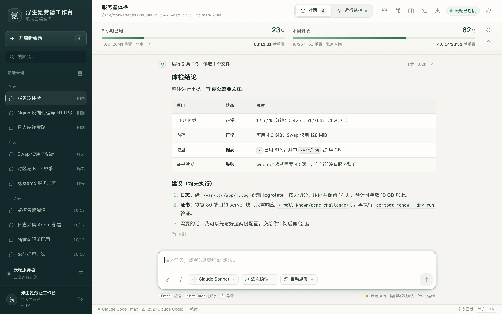
</p>

## 这是什么

**浮生氪劳德工作台**是一个部署在你自己服务器上的网页应用。它在服务器上运行官方的 [Claude Code](https://code.claude.com/docs/en/overview) CLI，把对话、工具审批、终端、工作区文件与运行监控整合进一个页面。

打开浏览器（电脑或手机都行），用自然语言告诉 Claude 你想做什么：检查服务器、写配置、看日志、排查故障。它会在服务器上一步步执行，每一条命令、每一处文件改动都实时呈现在你眼前。重要的操作，**在你点下「允许」之前不会执行**。

| 你说 | Claude 在服务器上做 |
| --- | --- |
| 「给这台服务器做一次体检，只读，别改东西。」 | 查看负载、内存、磁盘与失败的服务，汇总成一份结论 |
| 「帮我配好 Nginx 反向代理和 HTTPS。」 | 写配置、`nginx -t` 校验，等你批准后再平滑重载 |
| 「/var/log 越来越大，配一下日志轮转。」 | 生成 logrotate 配置并解释每一项的作用 |
| 「证书续期失败了，看看为什么。」 | 读日志、定位原因、给出修复方案，由你决定是否执行 |

## 功能亮点

<table>
<tr>
<td width="50%" valign="top">

**💬 流式对话**<br>
思考、工具调用与回复逐字呈现。任务在服务器上运行，刷新页面、断网重连都不丢进度。

</td>
<td width="50%" valign="top">

**🛡️ 逐次确认**<br>
命令、文件改动与执行计划都会变成审批卡片。看清完整命令和差异，再决定允许还是拒绝。

</td>
</tr>
<tr>
<td valign="top">

**🖥️ 网页终端**<br>
基于 xterm.js 与真实 PTY。可以打开普通 Shell，也可以打开原生 Claude Code 界面。

</td>
<td valign="top">

**📁 会话工作区**<br>
每个会话一个独立目录，内置 Monaco 编辑器、文件搜索、上传下载与 Git 状态。

</td>
</tr>
<tr>
<td valign="top">

**📈 运行监控**<br>
Token 构成、上下文占用、执行轨迹、文件活动与 API 等价费用估算，每一步都看得见。

</td>
<td valign="top">

**⏱️ 额度一目了然**<br>
5 小时与每周额度、重置倒计时，直接读取官方 `/usage`，对话中遇到限流也会即时更新。

</td>
</tr>
<tr>
<td valign="top">

**📱 手机也好用**<br>
响应式布局。人在路上，也能看进度、批准操作。另有桌面通知与 <kbd>Ctrl</kbd> + <kbd>K</kbd> 命令面板。

</td>
<td valign="top">

**🔒 安全的默认值**<br>
只监听本机，scrypt 口令，来源校验与 CSRF 令牌，严格的 CSP，systemd 加固，默认不能 sudo。

</td>
</tr>
<tr>
<td valign="top">

**🧩 插件底座**<br>
一个 `manifest.json` 加一个 JS 文件就是一个插件：面板、监控小组件、桌面宠物、状态栏，都运行在隔离沙箱里，只能使用你授予的权限。

</td>
<td valign="top">

**🎨 创意工坊与皮肤**<br>
在页面里浏览、一键安装社区作品，安装包校验 sha256。11 款皮肤，终端、编辑器和插件一起换色。

</td>
</tr>
</table>

## 截图

<table>
<tr>
<td width="50%">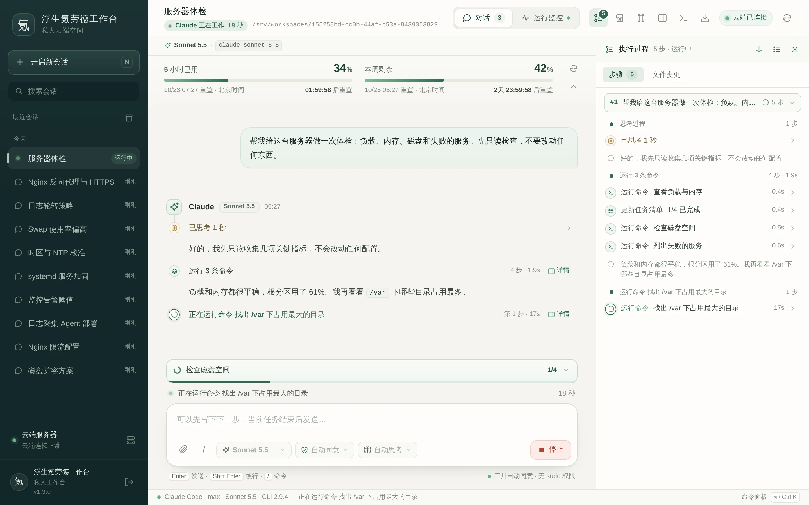</td>
<td width="50%">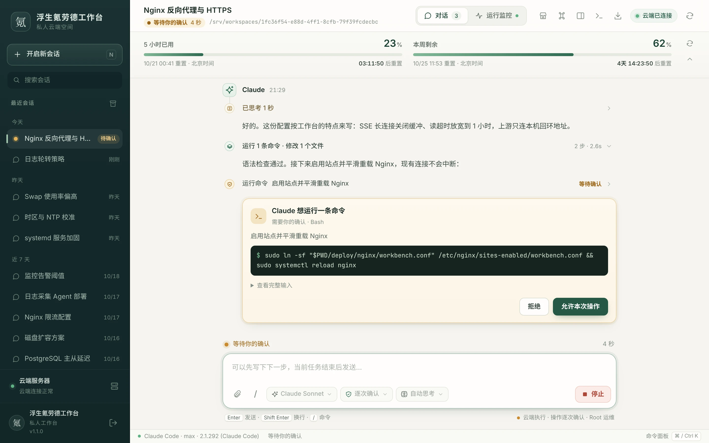</td>
</tr>
<tr>
<td align="center"><sub><b>实时执行</b> · 每一次工具调用都在时间线上展开</sub></td>
<td align="center"><sub><b>逐次确认</b> · 特权命令执行前，由你亲自批准</sub></td>
</tr>
<tr>
<td>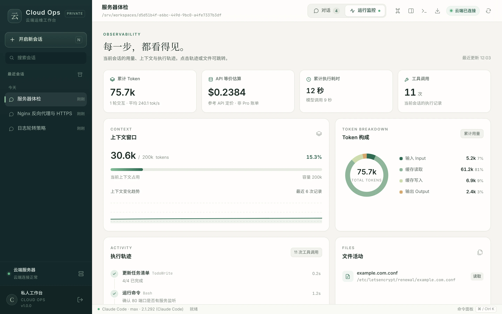</td>
<td>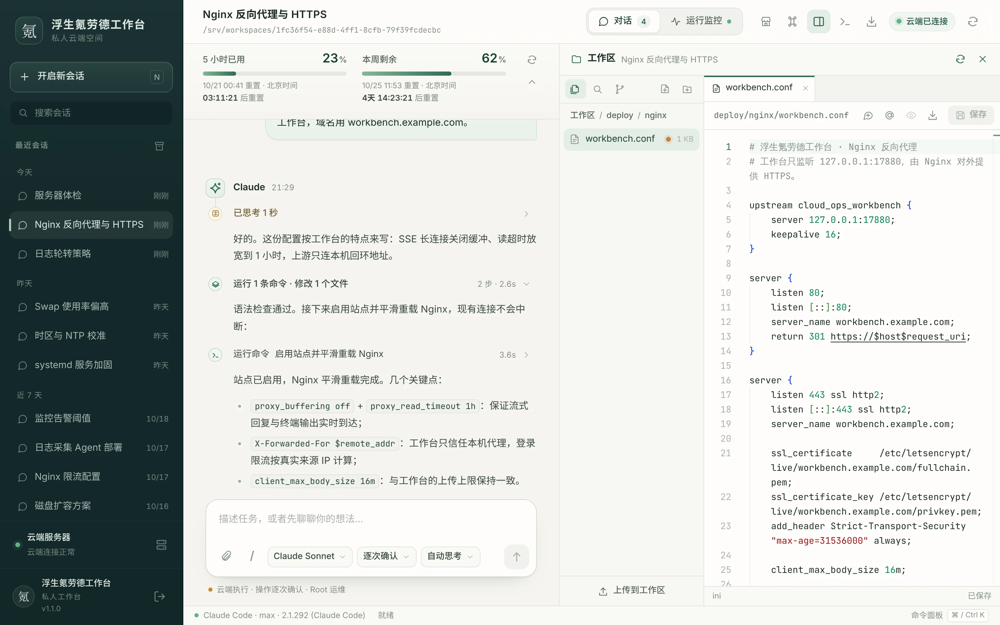</td>
</tr>
<tr>
<td align="center"><sub><b>运行监控</b> · 用量、上下文与执行轨迹</sub></td>
<td align="center"><sub><b>会话工作区</b> · Claude 写的文件，直接在网页里审阅</sub></td>
</tr>
<tr>
<td>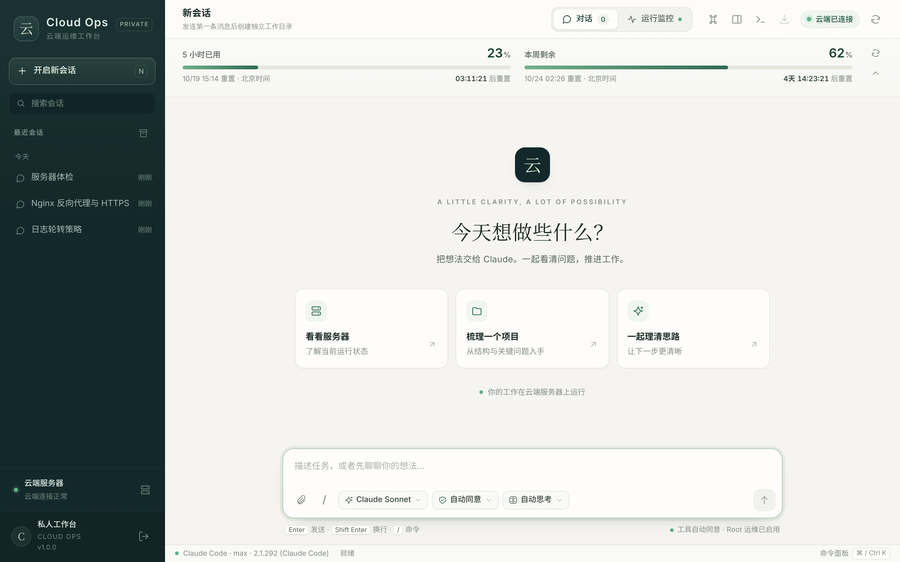</td>
<td>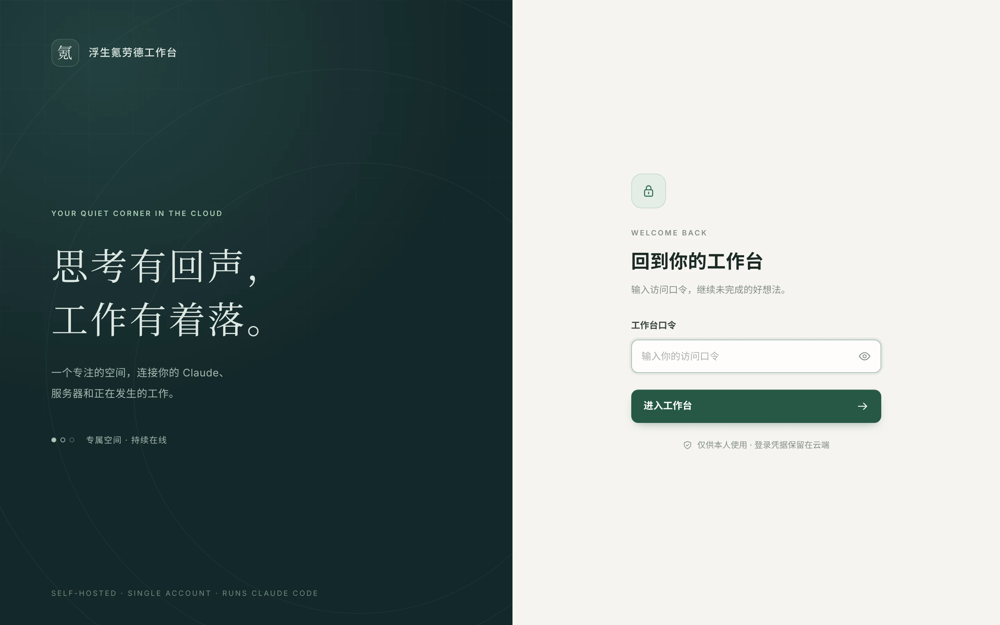</td>
</tr>
<tr>
<td align="center"><sub><b>新会话</b> · 从一句话开始</sub></td>
<td align="center"><sub><b>登录</b> · 仅供本人使用的私人工作台</sub></td>
</tr>
</table>

<p align="center">
  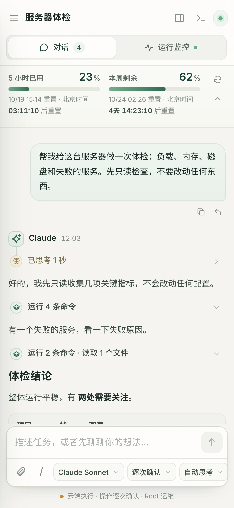
  &nbsp;&nbsp;
  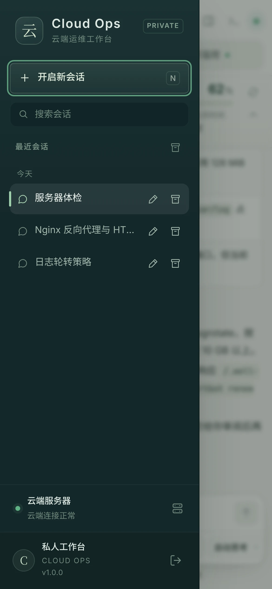
</p>
<p align="center"><sub><b>移动端</b> · 随时随地查看进度、批准操作</sub></p>

## 插件、创意工坊与皮肤

工作台是一个可以扩展的底座。统计用量、养一只宠物、给监控页加一块看板，或者换一套顺眼的配色，都可以做成插件和皮肤，在顶栏的 **创意工坊** 里一键安装。

<p align="center">
  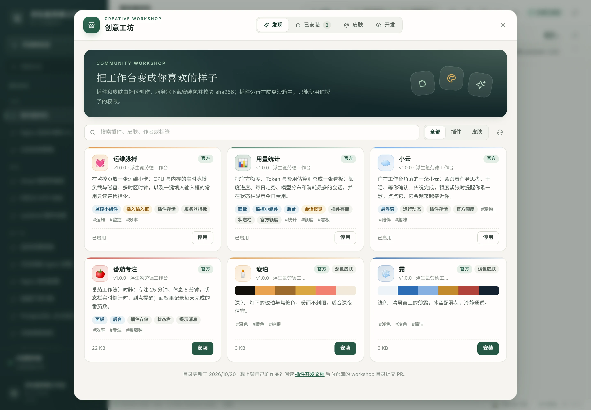
</p>

<table>
<tr>
<td width="50%"></td>
<td width="50%">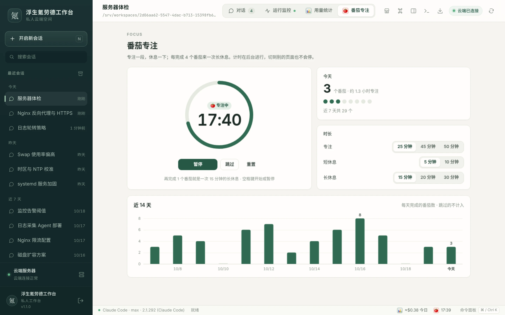</td>
</tr>
<tr>
<td align="center"><sub><b>用量统计</b> · 额度走势、每日费用与模型分布</sub></td>
<td align="center"><sub><b>番茄专注</b> · 状态栏倒计时，记录每天的专注</sub></td>
</tr>
<tr>
<td>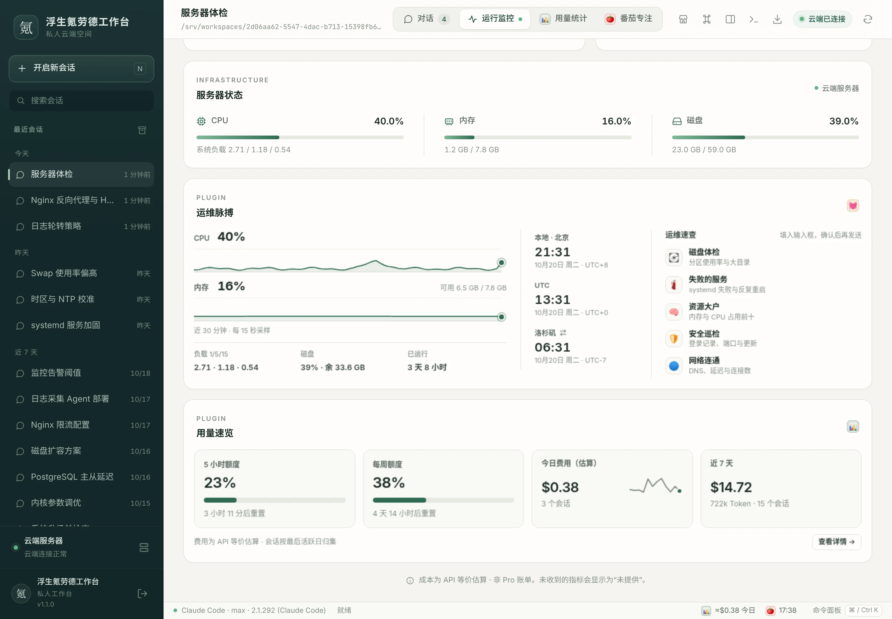</td>
<td>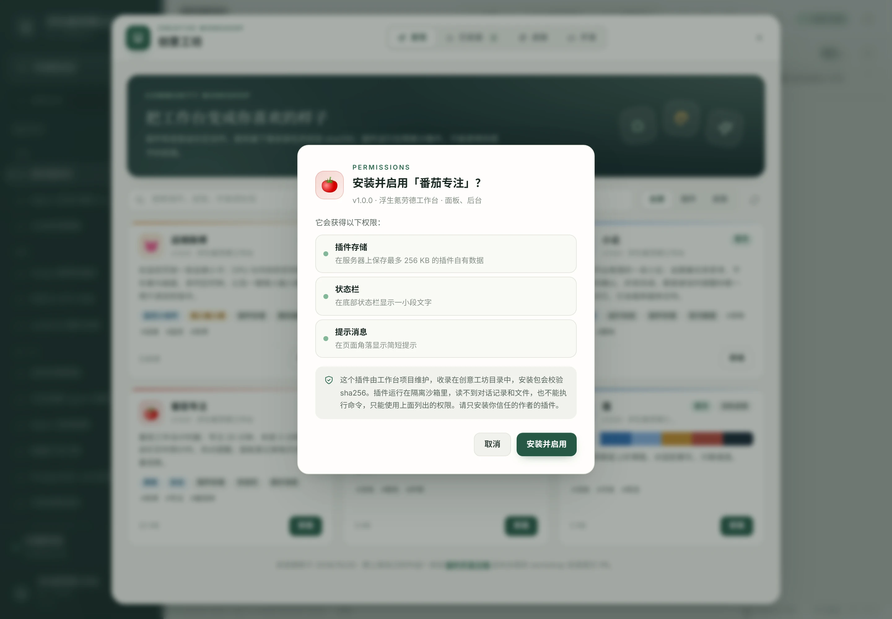</td>
</tr>
<tr>
<td align="center"><sub><b>监控小组件</b> · 实时脉搏、多时区时钟与用量速览</sub></td>
<td align="center"><sub><b>权限确认</b> · 安装前看清插件能做什么</sub></td>
</tr>
</table>

| 作品 | 界面 | 说明 |
| --- | --- | --- |
| 📊 用量统计 | 面板 · 小组件 · 状态栏 | 额度走势、每日费用估算、模型分布与消耗最多的会话 |
| 💓 运维脉搏 | 小组件 | CPU 与内存的实时脉搏、多时区时钟，一键填入只读巡检指令 |
| ☁️ 小云 | 悬浮窗 | 跟着任务思考、干活、庆祝的桌面宠物，额度紧张时提醒你歇一歇 |
| 🍅 番茄专注 | 面板 · 后台 · 状态栏 | 番茄工作法计时器，来自创意工坊 |

前三个随工作台内置，默认不启用。**11 款皮肤**里有 9 款内置，琥珀和霜来自创意工坊：

<table>
<tr>
<td width="50%">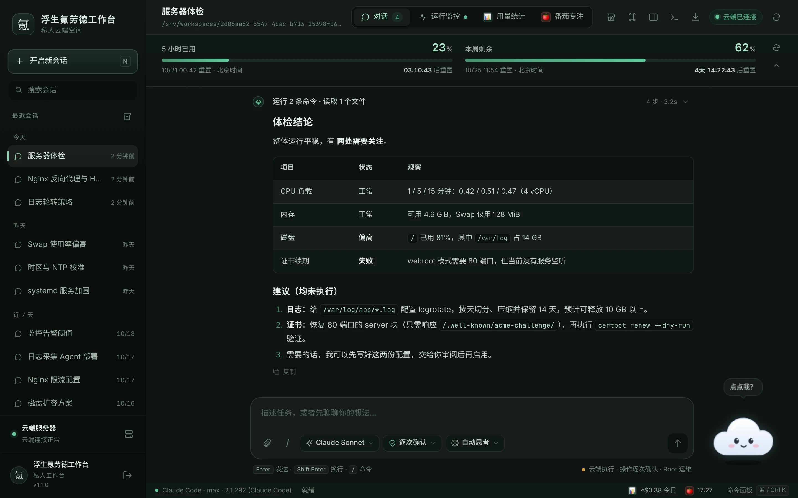</td>
<td width="50%">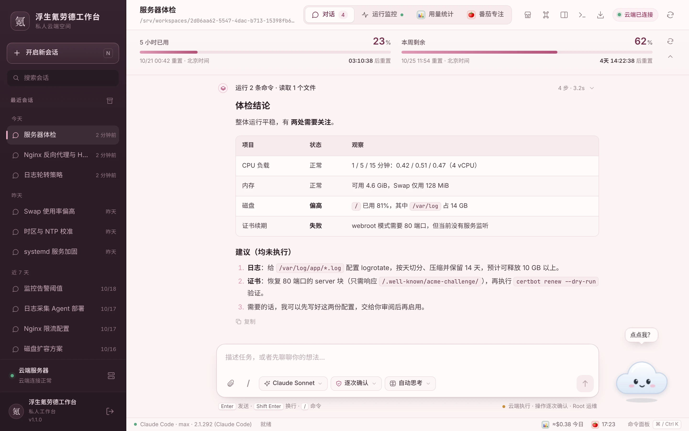</td>
</tr>
<tr>
<td align="center"><sub><b>墨夜</b> · 墨绿夜色，适合长时间值守</sub></td>
<td align="center"><sub><b>樱</b> · 樱花粉与梅紫，柔和明亮</sub></td>
</tr>
<tr>
<td>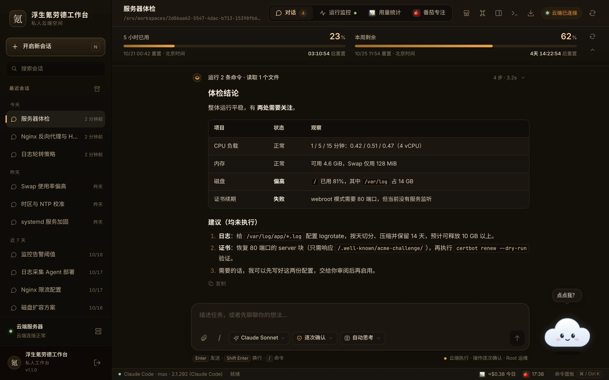</td>
<td>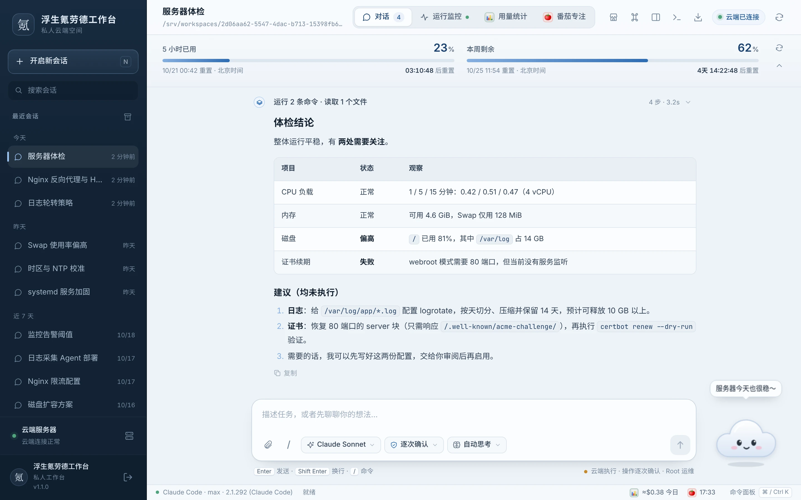</td>
</tr>
<tr>
<td align="center"><sub><b>琥珀</b> · 灯下的琥珀与焦糖色</sub></td>
<td align="center"><sub><b>霜</b> · 冰蓝配雾灰，冷静通透</sub></td>
</tr>
</table>

**自己做一个**只需要几分钟：

```bash
npm run plugin:new -- my-plugin    # 生成一个带面板、小组件和命令的插件（加 --theme 生成皮肤）
npm run plugin:pack -- my-plugin   # 打包成一个文件，发给朋友导入
```

插件运行在隔离的沙箱里，读不到对话记录、文件和凭据，也不能执行命令；它能用的每一项权限都要你确认。完整的 SDK、皮肤变量和上架流程见 **[插件与皮肤开发指南](docs/PLUGINS.md)**，欢迎向 [`workshop/`](workshop) 提交你的作品。

## 工作原理

工作台本身**不调用任何模型接口**。它是官方 Claude Code CLI 的「遥控器」：把网页上的操作翻译成 CLI 的 `stream-json` 协议，再把 CLI 的流式输出实时推回浏览器。

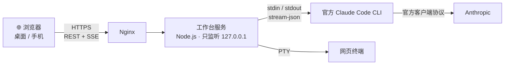

1. **原样调用官方 CLI**：每轮对话启动一次 `claude -p --input-format stream-json --output-format stream-json …`。登录认证、模型请求、工具执行都由 CLI 自己完成，工作台不读取、也不保存你的 Claude 凭据。
2. **审批走 stdio**：`--permission-prompt-tool stdio` 把权限请求交给工作台，变成网页上的审批卡片，你的决定再原路交还给 CLI。
3. **实时推送**：CLI 的流式事件被整理成带序号的增量补丁，通过 SSE 推送；发现缺口就自动重新取快照。
4. **一次只做一件事**：同一时间只运行一轮对话或一个终端，避免多个任务同时修改同一台服务器。

完整的协议流程、时序图与设计取舍见 **[工作原理](docs/ARCHITECTURE.md)**。

## 快速开始

**准备**：一台你拥有管理权限的 Linux 服务器，Node.js ≥ 20、npm、git 与 python3（网页终端需要），并已按 [官方文档](https://code.claude.com/docs/en/setup) 安装 Claude Code，用**你自己的账号**完成登录。

```bash
git clone https://github.com/qiuxinyuan321/cloud-ops-workbench.git
cd cloud-ops-workbench
npm ci
npm run build          # 打包 Monaco 编辑器；不打包时编辑器会退化为纯文本框
npm run set-password   # 设置登录口令（至少 12 个字符，只保存 scrypt 哈希）
npm start              # 监听 http://127.0.0.1:17880
```

工作台只监听本机。在**你自己的电脑**上建立 SSH 隧道，然后用浏览器打开 <http://127.0.0.1:17880>：

```bash
ssh -N -L 17880:127.0.0.1:17880 you@your-server
```

> [!TIP]
> 只给自己用时，SSH 隧道是最安全的方式：不需要域名和证书，也不用开放任何 Web 端口。

## 生产部署

长期使用时，建议按 **[部署指南](docs/DEPLOYMENT.md)** 部署为 systemd 服务，并通过 Nginx 提供 HTTPS。`deploy/` 目录里有可以直接使用的示例：

| 文件 | 用途 |
| --- | --- |
| [`deploy/systemd/cloud-ops-workbench.service`](deploy/systemd/cloud-ops-workbench.service) | 以专用普通账号运行，默认启用 systemd 加固 |
| [`deploy/nginx/cloud-ops-workbench.conf`](deploy/nginx/cloud-ops-workbench.conf) | HTTPS 反向代理，已为 SSE 长连接关闭缓冲 |
| [`deploy/systemd/root-operations.conf`](deploy/systemd/root-operations.conf) | 可选：开启 Root 运维时使用的覆盖配置 |
| [`deploy/sudoers/cloud-ops-workbench.example`](deploy/sudoers/cloud-ops-workbench.example) | 可选：只授权具体命令的 sudoers 示例 |

## 配置

所有配置都通过环境变量完成，模板见 [`.env.example`](.env.example)。

| 变量 | 默认值 | 说明 |
| --- | --- | --- |
| `WORKBENCH_ORIGIN` | `http://127.0.0.1:17880` | 浏览器访问地址，必须与地址栏**完全一致**（协议、域名、端口），所有写操作都会校验 |
| `WORKBENCH_HOST` | `127.0.0.1` | 监听地址。请保持本机回环，由 Nginx 或 SSH 隧道对外提供访问 |
| `PORT` | `17880` | 监听端口 |
| `WORKBENCH_DATA` | `./data` | 数据目录：会话记录、口令哈希、登录状态与插件 |
| `WORKBENCH_WORKSPACES` | `<WORKBENCH_DATA>/workspaces` | 会话工作区的根目录 |
| `WORKBENCH_AUTH_FILE` | `<WORKBENCH_DATA>/auth.json` | 口令哈希文件 |
| `CLAUDE_BINARY` | `claude` | Claude Code 可执行文件，默认从 `PATH` 查找 |
| `WORKBENCH_ROOT_OPERATIONS` | 未启用 | 设为 `1` 时告诉 Claude 可以按本机 sudo 策略执行特权命令。**它本身不授予任何权限**，详见 [Root 运维](SECURITY.md#root-运维) |
| `WORKBENCH_WORKSHOP_URL` | 本项目的 [`workshop/`](workshop) | 创意工坊目录地址，只接受 HTTPS。设为 `off` 关闭创意工坊，导入插件包不受影响 |
| `WORKBENCH_SAFE_MODE` | 未启用 | 设为 `1` 时禁用所有插件，用于排查问题。只想临时排查时，在地址后加 `?safe` 即可 |

## 安全模型

> **登录口令 = 服务账号的 Shell。** 请像保护 SSH 私钥一样保护它。

- **默认只监听 `127.0.0.1`**，公网访问只走 HTTPS 或 SSH 隧道；
- 口令只保存 scrypt 哈希，登录限流；会话 Cookie 带有 `HttpOnly`、`SameSite=Strict`，在 HTTPS 下另加 `Secure`；
- 所有写操作都要校验来源与 CSRF 令牌；严格的 CSP，不加载任何外部资源；
- 以专用普通账号运行，systemd 加固，**默认不能使用 sudo**；需要时只按命令授权，并配合「逐次确认」模式使用；
- 插件运行在不透明源的沙箱 iframe 中，只能通过受权限控制的通道读取你授予的数据，服务器从不执行插件代码。

威胁模型、防护边界与部署检查清单见 **[SECURITY.md](SECURITY.md)**。

## 项目结构

```text
cloud-ops-workbench/
├── server.mjs              # Express 应用：鉴权、REST、SSE、对话调度
├── lib/
│   ├── claude-runner.mjs   # CLI 子进程与 stream-json 协议解析
│   ├── state.mjs           # 会话状态与持久化
│   ├── live.mjs            # 带序号的增量补丁
│   ├── usage.mjs           # 官方 /usage 额度查询
│   ├── workspace.mjs       # 工作区文件、搜索、Git 与路径边界检查
│   ├── terminal.mjs        # 网页终端
│   ├── pty-bridge.py       # PTY 桥接与进程清理
│   ├── plugins.mjs         # 插件与皮肤的校验、安装、沙箱页面和创意工坊
│   └── …                   # 鉴权、环境隔离、系统监控、Root 运维开关
├── public/                 # 单页应用：index.html · app.js · styles.css
│   ├── plugin-host.js      # 插件宿主：沙箱 iframe 与权限通道
│   ├── plugin-sdk/         # 插件 SDK（window.workbench）与基础样式
│   ├── themes.js           # 内置皮肤与皮肤变量
│   └── workshop.js         # 创意工坊界面
├── plugins/                # 内置插件：用量统计 · 运维脉搏 · 小云
├── workshop/               # 创意工坊目录：作品源码、插件包与 registry.json
├── scripts/                # 编辑器打包、口令设置、插件脚手架与打包
├── deploy/                 # systemd · Nginx · sudoers 示例
├── docs/                   # 工作原理、部署指南、插件开发指南与截图
└── test/                   # node --test 测试
```

## 开发与测试

```bash
npm test                            # node --test：鉴权、协议解析、实时补丁、工作区边界、终端、插件沙箱……
npm run plugin:new -- my-plugin     # 生成插件（--theme 生成皮肤）
npm run plugin:pack -- my-plugin    # 打包插件
npm run workshop:build              # 重建创意工坊目录（--check 只检查）
```

前端是没有框架的原生 JavaScript，`public/` 下的文件改完刷新页面即可生效；服务端的改动需要重启 `npm start`。

## 常见问题

<details>
<summary><b>能在中国大陆使用吗？</b></summary>
<br>

不能。Claude 只在 Anthropic [支持的国家和地区](https://www.anthropic.com/supported-countries) 提供服务，中国大陆不在其中。根据 Anthropic 的 [支持地区政策](https://www.anthropic.com/legal/supported-regions)，人在不受支持的地区时使用同样不被允许。把 Claude Code 部署在海外服务器上，并不会改变你所在的地区。本项目不面向、也不支持这类使用，详见 [免责声明](DISCLAIMER.md#4-地区限制与跨地区使用)。

</details>

<details>
<summary><b>为什么只支持一个账号？可以给朋友或团队用吗？</b></summary>
<br>

工作台是为「一个人运维自己的服务器」设计的。Anthropic 的条款不允许共享账号、转售或中转访问，Pro 与 Max 套餐的额度也以普通的个人使用为前提。请不要把部署好的工作台开放给他人使用。团队场景请使用 Anthropic 提供的 Team、Enterprise 套餐或 API。

</details>

<details>
<summary><b>工作台会接触我的 Claude 登录凭据吗？</b></summary>
<br>

不会。登录通过 Claude Code 自带的官方流程完成，凭据由 CLI 自己保存在服务账号的配置目录里。工作台只启动 CLI 进程，还会在启动前移除可能改变账号或服务商的环境变量，确保 CLI 使用你登录的那一个账号。

</details>

<details>
<summary><b>为什么需要 python3？</b></summary>
<br>

网页终端通过 `lib/pty-bridge.py` 创建真实的伪终端，并在关闭终端时清理它启动的所有后代进程。没有 python3 时，除终端之外的功能都能正常使用。

</details>

<details>
<summary><b>不用 Nginx 可以吗？</b></summary>
<br>

可以。只有你自己使用时，SSH 隧道是最简单也最安全的方式，见 [快速开始](#快速开始)。只有需要在没有 SSH 的设备（例如手机）上访问时，才需要配置 HTTPS。

</details>

<details>
<summary><b>页面上的额度和费用准确吗？</b></summary>
<br>

额度来自官方 `claude /usage` 的输出，缓存 90 秒，对话中遇到限流时会即时更新。费用是 CLI 给出的 **API 等价估算**，用来直观感受消耗，不是订阅账单。一切以 Anthropic 官方的显示为准。

</details>

<details>
<summary><b>「Root 运维」安全吗？</b></summary>
<br>

默认部署下 Claude 无法使用 sudo。如果你需要它代为重载 Nginx、续期证书，请只在 sudoers 里授权这些**具体命令**，并使用「逐次确认」模式。永远不要授权 `NOPASSWD: ALL`。详见 [SECURITY.md · Root 运维](SECURITY.md#root-运维)。

</details>

<details>
<summary><b>第三方插件安全吗？</b></summary>
<br>

插件运行在不透明源的沙箱 iframe 里，拿不到工作台的 Cookie 和页面内容，读不到对话记录、文件和凭据，不能执行命令，内容安全策略也不允许它连接外部地址；它只能使用你启用时确认过的权限。创意工坊的安装包会校验 sha256。不过沙箱不是万能的：插件可以在自己的面板里画出仿冒的界面，可能通过 WebRTC 等少数通道把它有权看到的数据带出去，拥有「插入输入框」权限的插件还可以放入误导性的文字。请只安装你信任的作者的插件，发送前读一遍输入框里的内容。详见 [插件开发指南 · 安全模型](docs/PLUGINS.md#安全模型)。

</details>

<details>
<summary><b>创意工坊打不开怎么办？</b></summary>
<br>

创意工坊的目录托管在本仓库，由服务器从 GitHub 下载。服务器访问不了时，「发现」页会给出提示，你仍然可以在「开发」页导入插件包；也可以把 `workshop/` 放到你自己的 HTTPS 地址，用 `WORKBENCH_WORKSHOP_URL` 指向它，或设为 `off` 关闭创意工坊。

</details>

<details>
<summary><b>插件或皮肤把页面弄乱了怎么办？</b></summary>
<br>

在地址后加 `?safe` 打开页面，进入安全模式：不加载任何插件，固定使用默认皮肤。然后在「创意工坊」的「已安装」页停用或卸载出问题的插件，在「皮肤」页卸载出问题的皮肤。

</details>

## 社区

<a href="DISCLAIMER.md#9-社区交流群"></a>

欢迎加入爱好者交流群 **820116443**，交流部署与使用心得。交流群不是 Anthropic 的官方渠道，本项目也不提供、不推荐任何第三方账号、额度或 API 中转服务，详见 [免责声明 · 社区交流群](DISCLAIMER.md#9-社区交流群)。

Bug 与建议请提交 [Issue](https://github.com/qiuxinyuan321/cloud-ops-workbench/issues)；安全问题请按 [SECURITY.md](SECURITY.md#报告安全问题) 私下报告。

## 免责声明

本项目是**非官方**的爱好者自用项目，按「现状」提供，不附带任何担保。你需要自行遵守 Anthropic 的 [消费者服务条款](https://www.anthropic.com/legal/consumer-terms)、[使用政策](https://www.anthropic.com/legal/aup) 与 [支持地区政策](https://www.anthropic.com/legal/supported-regions)。因跨地区使用、违反条款、配置不当或 AI 误操作造成的任何损失，包括账号封禁、数据丢失与服务中断，均由使用者自行承担。

**完整内容请阅读 [DISCLAIMER.md](DISCLAIMER.md)。**

## 许可证

[MIT](LICENSE) © 2026 qiuxinyuan321

Claude、Claude Code 与 Anthropic 是 Anthropic PBC 的商标。本项目与 Anthropic 没有任何隶属、合作或背书关系。

<div align="center">
<br>
<sub>如果这个项目对你有帮助，欢迎点一颗 ⭐</sub>
</div>
