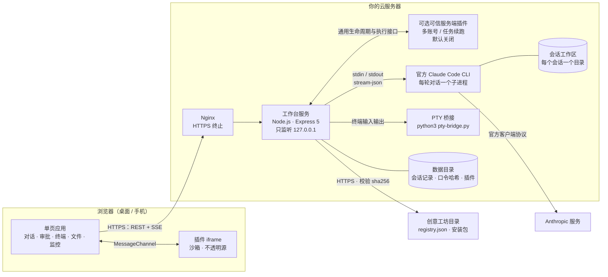
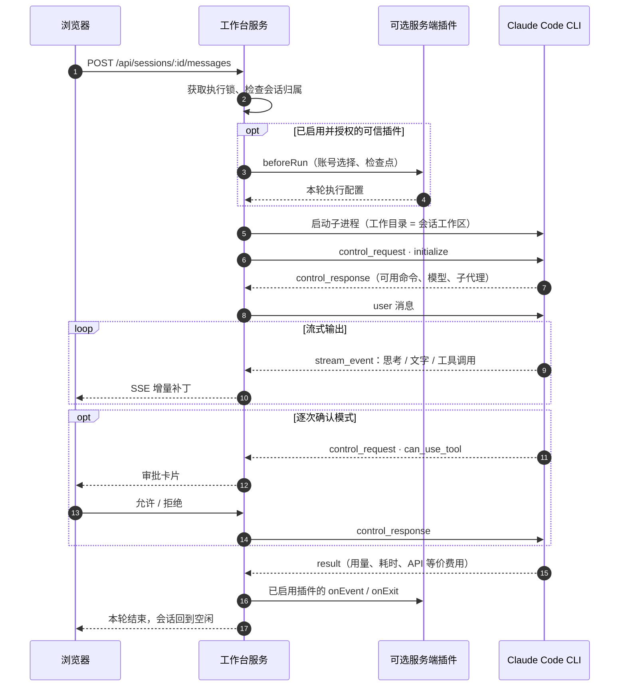
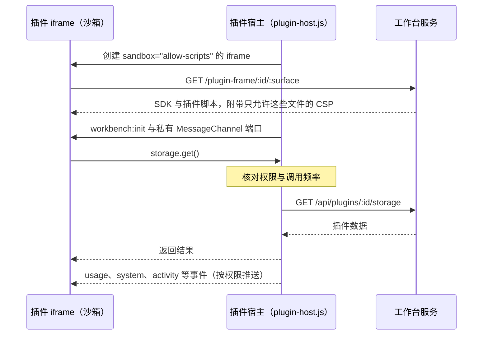

# 工作原理

> **一句话**：工作台是一个运行在你自己服务器上的 Node.js 服务。它把浏览器里的操作翻译成官方 Claude Code CLI 的 `stream-json` 协议，再把 CLI 的流式输出实时推回浏览器。
> 工作台不实现模型请求，不改动 CLI，也不读取或复制 Claude 登录凭据。额外账号的认证材料仍由官方 CLI 保存在插件为其选择的独立目录中。

部署环境检查、Agent 部署入口及升级流程见 [部署指南](DEPLOYMENT.md)。

- [总览](#总览)
- [一轮对话是怎样跑起来的](#一轮对话是怎样跑起来的)
- [关键设计](#关键设计)
- [数据存放在哪里](#数据存放在哪里)
- [代码导览](#代码导览)

---

## 总览



| 组件 | 职责 |
| --- | --- |
| **单页应用**（`public/`） | 原生 JavaScript，无前端框架。负责渲染对话、工具步骤、审批卡片、额度、监控面板、Monaco 编辑器与 xterm.js 终端。 |
| **工作台服务**（`server.mjs`、`lib/`） | 登录鉴权、会话存储、启动与管理 CLI 子进程、把 CLI 事件整理成网页可用的状态，并通过 SSE 推送。 |
| **Claude Code CLI** | 官方、未修改的 `claude` 命令。真正与 Anthropic 通信、调用工具、执行命令的都是它。 |
| **PTY 桥接**（`lib/pty-bridge.py`） | 为网页终端提供真实的伪终端，并负责清理终端里启动的后代进程。 |
| **普通插件与皮肤**（`public/plugin-host.js`、`lib/plugins.mjs`） | 插件界面运行在沙箱 iframe，通过受权限控制的消息通道调用 SDK；其 JS 不在服务端执行。皮肤只是一组颜色变量。 |
| **服务端插件通用宿主**（`lib/server-plugins.mjs`） | 仅为管理员随源码安装、显式授权的可信后端提供调用桥、生命周期、执行配置和会话归属门禁。 |
| **可选功能**（`plugins/account-pool/`、`plugins/task-resume/`） | 分别管理账号策略与任务恢复；代码、清单版本和私有数据独立，默认关闭。 |

---

## 一轮对话是怎样跑起来的



工作台为每一轮对话启动一次 CLI，参数大致如下：

```bash
claude -p --verbose \
  --input-format stream-json --output-format stream-json \
  --include-partial-messages \
  --permission-prompt-tool stdio \
  --permission-mode <bypassPermissions | manual | plan> \
  --model <opus | sonnet | fable | haiku | claude-…> [--effort <level>] [--resume=<session-id>]
```

| 参数 | 作用 |
| --- | --- |
| `-p` + `stream-json` 输入输出 | 非交互模式，工作台与 CLI 之间用一行一个 JSON 对象双向通信。 |
| `--include-partial-messages` | 逐字输出思考与回复，网页上实时可见。 |
| `--permission-prompt-tool stdio` | 工具权限请求经 stdio 交给工作台，按会话的权限模式自动处理或展示给用户。 |
| `--permission-mode` | 对应「自动同意 / 逐次确认 / 只读计划」；新会话默认自动同意（`bypassPermissions`）。 |
| `--model` | 模型别名或指定版本（如 `claude-opus-4-6`）。可选项取自 CLI 在 `initialize` 应答里报告的模型列表；参数只接受别名或 `claude-…` 形式，其他值不会启动 CLI。 |
| `--resume=<id>` | 续接同一个 Claude 会话，下一轮对话保留完整上下文。 |

一轮结束、CLI 进入空闲后，工作台关闭它的输入，进程自然退出。下一条消息会用 `--resume` 启动新进程续接上下文，所以服务器上没有常驻的 Claude 进程。

---

## 关键设计

### 1. 原样调用官方 CLI

工作台只是 CLI 的「遥控器」。认证、模型请求、工具执行、上下文压缩都由官方 CLI 完成，工作台不模拟、不代理、不改写任何对 Anthropic 的请求。好处有三点：

- **合规**：使用方式与你在终端里手动运行 `claude` 一样，受同一份服务条款约束；
- **省心**：CLI 升级后新能力自动可用，工作台从 `initialize` 应答里读取可用的命令与模型；
- **凭据不出 CLI**：登录状态保存在服务账号的 Claude 配置目录里，工作台从不读取。

### 2. 每个会话一个工作区

每个会话都有独立目录 `<WORKBENCH_WORKSPACES>/<会话 ID>`，它就是 CLI 的工作目录。Claude 生成的文件默认落在这里，网页右侧的文件面板也只浏览这里。

网页文件接口有严格的边界检查：打开文件时使用 `O_NOFOLLOW`，校验真实路径，并锚定到已验证的目录 inode，防止通过符号链接或竞争条件逃出工作区；Git 面板会拒绝含有符号链接或引用外部目录的仓库元数据。

> [!NOTE]
> 这个边界约束的是**网页文件接口**。Claude Code 本身和网页终端以服务账号身份运行，能访问该账号能访问的一切，这正是运维工具需要的能力。权限边界应当由服务账号、systemd 加固与 sudoers 来划定，见 [SECURITY.md](../SECURITY.md)。

### 3. 实时推送：SSE 与增量补丁

浏览器通过 `GET /api/events` 建立一条 SSE 长连接。正在进行的对话不会每次全量刷新，而是以带序号的小补丁推送（追加文字、更新工具状态等）：

- 打开会话时先取一次带序号的快照，之后只应用更新的补丁；发现序号缺口就自动重新取快照；
- 服务重启会更换纪元（`epoch`），所有序号随之重置；
- 积压超过 1 MB 的慢连接会被主动断开，避免拖垮服务。

### 4. 审批、提问与计划

CLI 需要权限时会发出 `can_use_tool` 请求，工作台按权限模式处理；需要用户确认或回答时展示对应卡片：

| 工具 | 卡片内容 |
| --- | --- |
| `Bash` | 命令说明与完整命令 |
| `Write` / `Edit` | 目标文件与差异预览 |
| `ExitPlanMode` | Claude 拟好的计划，批准后才开始执行 |
| `AskUserQuestion` | 渲染成选择题表单，你的回答会原样交还给 Claude |

新会话默认使用「自动同意」模式，工作台会代你批准普通工具请求，但 `AskUserQuestion` 仍然需要你亲自回答。需要审核工具调用时，用户必须主动选择「逐次确认」。发送给网页的工具输入会先脱敏：`sk-ant-` 密钥、Bearer 令牌以及名为 `password`、`api_key` 等的字段都会被替换为 `[REDACTED]`。

### 5. 额度与用量

- **官方额度**：工作台以只读方式运行 `claude -p /usage`（无工具、不保存会话），读取 5 小时与每周额度及重置时间，结果缓存 90 秒。对话过程中收到的限流事件也会即时更新显示。
- **会话用量**：Token、缓存命中、上下文窗口占用都来自 CLI 的流式事件和每轮结束时的 `result`。
- **费用**：显示的金额是 CLI 给出的 **API 等价估算**，用来直观感受消耗，不是订阅账单。

### 6. 网页终端

终端由浏览器里的 xterm.js 和服务器上的 `pty-bridge.py`（以 `python3 -I` 隔离模式运行）组成，可以打开普通 Shell，也可以直接打开原生 Claude Code 界面来运行 `/model`、`/mcp` 等交互命令。同一时间只允许一个终端运行；关闭终端时，桥接程序作为子进程收养者（subreaper）只清理它自己启动的后代进程，不会误杀其他程序。

### 7. 一次只做一件事

工作台同一时间只运行一轮对话或一个终端。可信插件的账号探测、账号配置修改与恢复启动也受同一执行互斥约束，不会与运行中的任务抢占。任务运行时，你可以先写好下一条消息，等当前任务结束后再发送。

收到 `SIGTERM` 时（例如 `systemctl stop`），工作台会先停止正在运行的任务与终端，把会话写回磁盘，然后退出。

### 8. 环境隔离

启动 CLI 前，工作台会从子进程环境中移除可能改变凭据、服务商或加载额外代码的变量：

```text
ANTHROPIC_API_KEY  ANTHROPIC_AUTH_TOKEN  ANTHROPIC_BASE_URL  ANTHROPIC_PROFILE  ANTHROPIC_FEDERATION_*
CLAUDE_CODE_OAUTH_TOKEN  CLAUDE_CODE_USE_BEDROCK  CLAUDE_CODE_USE_VERTEX  CLAUDE_CODE_USE_FOUNDRY
CLAUDE_CONFIG_DIR  CLAUDE_SECURESTORAGE_CONFIG_DIR  CLAUDECODE  NODE_OPTIONS  PYTHONPATH  PYTHONSTARTUP
```

清除外部环境覆盖后，宿主再应用可信插件返回的绝对 `configDir`。无账号插件时沿用服务账号的原官方配置；启用账号插件时，由该插件选择独立 `CLAUDE_CONFIG_DIR`，客户端请求不能直接指定配置路径。代理相关变量（`HTTPS_PROXY`、`NO_PROXY` 等）会原样保留。

### 9. Root 运维开关

`WORKBENCH_ROOT_OPERATIONS=1` 只做一件事：通过 `--append-system-prompt` 告诉 Claude，服务器所有者允许它按本机 sudo 策略执行特权命令，并提醒它控制改动范围、重启前先备份。**它本身不授予任何权限**，Claude 实际能做什么完全由服务账号的 sudoers 规则决定。

### 10. 插件与创意工坊

普通界面插件运行在浏览器里，服务器只保存其文件与 SDK 数据。管理员随源码安装的可信服务端插件使用另一个通用宿主，只有显式启用并授予 `backend` 权限才加载。它们运行在 Node.js 服务进程中，不受浏览器沙箱隔离。



- **插件宿主**（`public/plugin-host.js`）为插件的每个界面（面板、小组件、浮层、后台）创建一个沙箱 iframe。页面由服务器的 `/plugin-frame/:id/:surface` 生成：先加载 SDK，再加载插件自己的脚本，附带的内容安全策略只允许这两部分文件。插件文件通过带 HMAC 签名的地址提供，因为不透明源的页面不会带上登录 Cookie。
- iframe 加载后，宿主用 `postMessage` 把一个私有的 `MessageChannel` 端口交给它，此后插件的每次调用都走这个通道。宿主先核对权限与频率，再用页面已有的数据作答，需要时以工作台页面自己的登录状态调用接口，例如会话统计和插件存储。插件本身拿不到 Cookie，也无法直接调用工作台接口。
- 可信插件的 `wb.backend.call(method, params)` 也走该通道，宿主固定为当前插件 ID，再请求 `/api/plugins/:id/backend`。服务端继续核对认证、Origin、CSRF、权限与内置来源。普通导入包和开发目录不能加载服务端入口。
- 会话、额度、服务器指标与运行动态，由宿主按插件获得的权限转发成事件。
- **皮肤**是一组 CSS 颜色变量，安装时由服务器逐个校验。`public/themes.js` 把皮肤应用到页面、终端与编辑器；`public/theme-boot.js` 在样式表生效之前重放上一次的皮肤，深色皮肤打开时不会闪白。
- **创意工坊**是一个静态目录：`workshop/registry.json` 列出作品，`workshop/packages/` 存放安装包，两者都由 `npm run workshop:build` 从 `workshop/src/` 生成。工作台通过 HTTPS 读取目录，安装时下载安装包、校验 sha256，再解包到数据目录。`WORKBENCH_WORKSHOP_URL` 可以换成自建的目录，或者设为 `off` 关闭创意工坊。

接口与权限的完整说明见 [插件与皮肤开发指南](PLUGINS.md)，安全边界见 [SECURITY.md](../SECURITY.md#插件与创意工坊)。

### 11. 可选后端的生命周期与独立维护

`lib/server-plugins.mjs` 只处理通用行为：加载已启用的可信模块、转发方法、按顺序调用运行钩子、核验返回的执行配置、记录会话归属。声明 `managesExecutionContext: true` 的插件会在 `beforeRun` 前先登记归属，即使准备或后续钩子失败也不会失去保护；成功返回 `ownsContext: false` 时可解除归属。所有账号策略和任务恢复规则都在相应 `plugins/<id>/` 下；底座不包含特定账号列表、轮询算法或重试队列。

| 阶段 | 通用宿主 | 插件自己的处理 |
| --- | --- | --- |
| 启用 | 校验清单与授权，调用 `activate(context)` | 打开独立数据目录，校验元数据；坏文件保留并报错 |
| 查看就绪 | 收集 `executionStatus()` | 账号插件空闲时按 TTL 核对官方登录状态，忙时只读缓存；返回 `ready`、简短标签和说明 |
| 开始一轮 | 持执行锁，检查归属，调用 `beforeRun` | 账号插件挑选配置、必要时迁移当前会话；续跑插件记录检查点 |
| 运行与退出 | 顺序转发 `onEvent`、`onExit`、`onStop` | 分别更新该账号的官方额度或该任务的状态；不混用彼此存储 |
| 停用 / 服务端安全模式 | 拒绝新调用，关闭模块，保留归属记录 | 停止监控与恢复队列，保留必要数据 |

宿主将插件就绪结果聚合为 `bootstrap.execution`，页面据此显示当前执行环境。插件修改账号或运行设置后通过 `context.runtimeChanged()` 通知页面刷新，不需要底座识别某个插件的方法名。

账号插件默认保留原官方配置，额外账号使用独立目录；支持保持当前、逐轮轮询与余量优先，以及固定会话绑定。跨账号只迁移当前官方会话 UUID 对应的 transcript、子代理记录和 file-history，拒绝链接和超限文件，不复制凭据或整个配置目录。已使用非默认配置的会话归属会持久化；插件停用后继续该会话会明确失败，直到恢复所需插件，避免无意改用默认账号。

续跑插件保存会话和轮次标识、标题、最后工具的名称/状态，使用官方 `--resume` 在原工作区启动下一轮，不复制对话正文或工具输入输出。自动恢复另行默认关闭，采用有限次数和退避等待；手动停止、等待用户与额度拒绝不自动继续。恢复会先要求 Claude 核对实际状态，不能保证已经提交的外部副作用恰好执行一次。

`?safe` 只禁用当前浏览器的插件界面，后端会继续工作。`WORKBENCH_SAFE_MODE=1` 加服务重启才会阻止服务端插件加载和调度；会话归属门禁仍然保留。插件与底座分别维护版本及测试，按 `engines.workbench` 检查兼容。更换后端源码需要重启服务；浏览器重新加载只刷新界面。

---

## 数据存放在哪里

```text
<WORKBENCH_DATA>/                  默认 ./data，目录权限 0700
├── auth.json                      登录口令的 scrypt 哈希（npm run set-password 生成）
├── web-sessions.json              浏览器登录状态（只保存令牌的 SHA-256 摘要）
├── models.json                    CLI 最近报告的模型列表；插件指定的配置目录只记录哈希
├── sessions/
│   └── <会话 ID>.json             对话记录、工具步骤、用量统计
├── plugins/                       已安装的插件与皮肤，以及开发中的插件，每个一个目录
├── plugin-data/
│   └── <插件 ID>.json             插件自己保存的数据（明文，每个最多 256 KB）
├── plugin-state.json              插件的启用状态与已授予的权限
├── server-plugin-data/            可信后端私有数据，与 SDK storage 分开
│   ├── session-contexts.json      通用宿主的会话配置归属记录
│   ├── account-pool/
│   │   ├── accounts.json          账号元数据、策略与会话绑定
│   │   └── profiles/<账号 ID>/config/  官方 CLI 独立配置（含 CLI 管理的认证材料）
│   └── task-resume/checkpoints.json   任务检查点与恢复设置
└── workspaces/                    默认工作区根目录（可用 WORKBENCH_WORKSPACES 另行指定）
    └── <会话 ID>/                 该会话的工作目录
```

服务进程以 `umask 077` 运行，新建文件只有服务账号自己可读写。默认账号的官方历史与凭据通常位于 `~/.claude`；额外账号由 CLI 保存在上述独立配置中。工作台不读取凭据，但包含这些目录的备份应作为敏感数据保护。停用内置插件不删除其数据。

---

## 代码导览

| 文件 | 内容 |
| --- | --- |
| `server.mjs` | Express 应用：安全响应头、来源与 CSRF 校验、REST 接口、SSE、对话调度、优雅退出 |
| `lib/claude-runner.mjs` | CLI 子进程管理与 `stream-json` 协议解析：流式事件、审批、用量、脱敏 |
| `lib/state.mjs` | 会话数据结构与持久化，把运行事件合并进会话状态 |
| `lib/live.mjs` | 带序号的增量补丁 |
| `lib/usage.mjs` | 官方 `/usage` 额度查询与限流事件 |
| `lib/workspace.mjs` | 工作区文件读写、搜索、Git 状态，以及路径边界检查 |
| `lib/terminal.mjs` · `lib/pty-bridge.py` | 网页终端与进程清理 |
| `lib/auth.mjs` | scrypt 口令校验、登录会话、登录限流 |
| `lib/claude-environment.mjs` | CLI 子进程的环境变量过滤 |
| `lib/system.mjs` | CPU、内存、磁盘采样与 CLI 登录状态 |
| `lib/root-operations.mjs` | Root 运维开关 |
| `lib/plugins.mjs` | 插件与皮肤：清单校验、安装与卸载、插件页面与文件、插件存储、创意工坊目录 |
| `lib/server-plugins.mjs` | 可信后端通用宿主：受权调用、生命周期、执行配置、就绪汇总与归属门禁 |
| `public/` | 单页应用：`index.html`、`app.js`、`styles.css` |
| `public/plugin-host.js` · `public/plugin-sdk/` | 插件宿主（沙箱 iframe、消息通道、权限检查），以及插件页面加载的 SDK 与基础样式 |
| `public/themes.js` · `public/theme-boot.js` | 内置皮肤与应用皮肤的逻辑；在首屏绘制前重放上一次的皮肤 |
| `public/workshop.js` | 创意工坊与插件管理界面 |
| `plugins/` | 默认关闭的内置插件；`account-pool/` 与 `task-resume/` 分别保存多账号和续跑实现 |
| `workshop/` | 创意工坊目录：作品源码、安装包与 `registry.json` |
| `scripts/` | Monaco 编辑器打包、口令设置、插件脚手架与打包（`plugin:new`、`plugin:pack`）、创意工坊目录生成（`workshop:build`） |
| `test/` | `node --test` 测试 |
